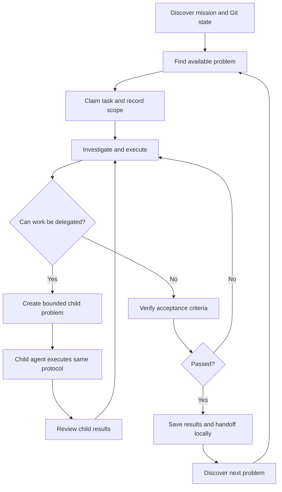

# Recursion principles

Recursion solves complex problems by expressing work as small tasks that can be understood, checked, and handed off independently. Tasks may create child tasks when useful; the parent remains responsible for integrating their results.

## Working principles

- **Files are durable memory.** Keep decisions, progress, and evidence in the repository.
- **Make tasks checkable.** State the intended result and how to verify it.
- **Keep tasks small.** Split work only when pieces can progress independently.
- **Preserve responsibility.** Every child names its parent, and each parent records integration.
- **Prefer simple tools.** Do not require a particular agent vendor or hosted service.
- **Work locally by default.** The repository owner decides when to commit or publish.

## Work cycle

Use this cycle to move from an available problem to a verified handoff. Save completed work and handoff notes in local files; the repository owner decides when to commit them.

## Initial proofs

1. **Cold start:** the initial language example runs from a clean checkout without generated compiler outputs.
2. **Bootstrap:** one compiler stage builds the next, and the next rebuilds the agreed target with a recorded comparison.

Keep the language and proofs small enough for another contributor to repeat.
